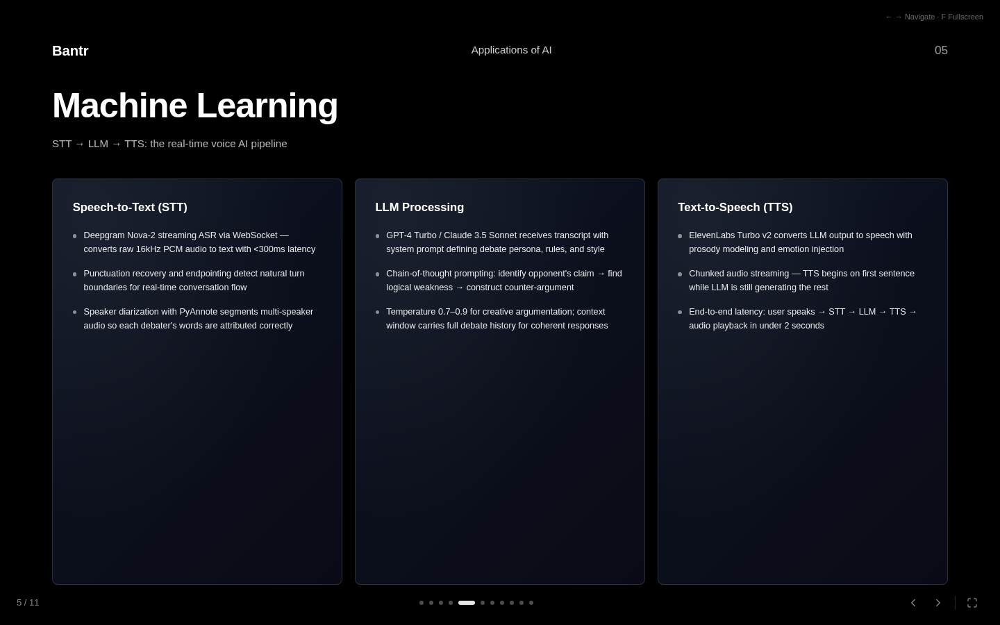

<p align="center">
  
</p>

<h1 align="center">Bantr: Applications of AI</h1>

<p align="center">An academic presentation about AI applications and an AI-assisted debate design.</p>

<div align="center">

[Main deck](#main-deck) · [Risk-sensitive deck](#risk-sensitive-deck) · [Controls](#controls) · [Local development](#local-development) · [Credits](#credits) · [License](#license)

</div>

## Main deck

The main deck has 11 slides. It presents the Bantr debate design and topics such as speech recognition, language models, speech synthesis, retrieval-augmented generation, and post-debate analysis.

<p align="center">
  
</p>

<p align="center"><sub>Slide 5 of the main deck, captured at <code>/?slide=5</code>.</sub></p>

## Risk-sensitive deck

The same app also serves a 12-slide risk-sensitive distributional actor-critic research deck for sales dialogue at `/rl-presentation`.

## Controls

- Use Right, Down, or Space to move to the next slide.
- Use Left or Up to return to the previous slide.
- Press F to enter or leave full-screen mode.
- Press Escape to leave full-screen mode.
- Use the on-screen arrows or progress dots to move between slides.

Add `?slide=N` to either route to open a slide by number. For example, `/?slide=4` opens the fourth slide in the main deck.

## Local development

Use Node.js and npm. The repository does not set a Node.js version. Run these commands from the repository root:

```bash
npm ci --no-audit --no-fund
npm run dev -- --host 127.0.0.1 --port 4173 --strictPort
```

The package file also defines these checks:

```bash
npm run build
npm run lint
```

The package file does not define a test script.

## Media

The slide backgrounds can load HLS video from Mux. The app requests this remote media while it runs.

## Credits

The README credits Abhiram, Ishita, and Pavan. The main deck cover also names Shreya.

## License

The README states: “This project is part of an academic research presentation and is not licensed for commercial use.” No separate LICENSE, COPYING, or NOTICE file is tracked.
